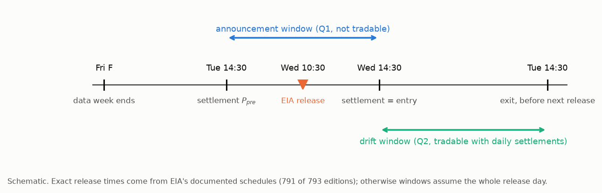
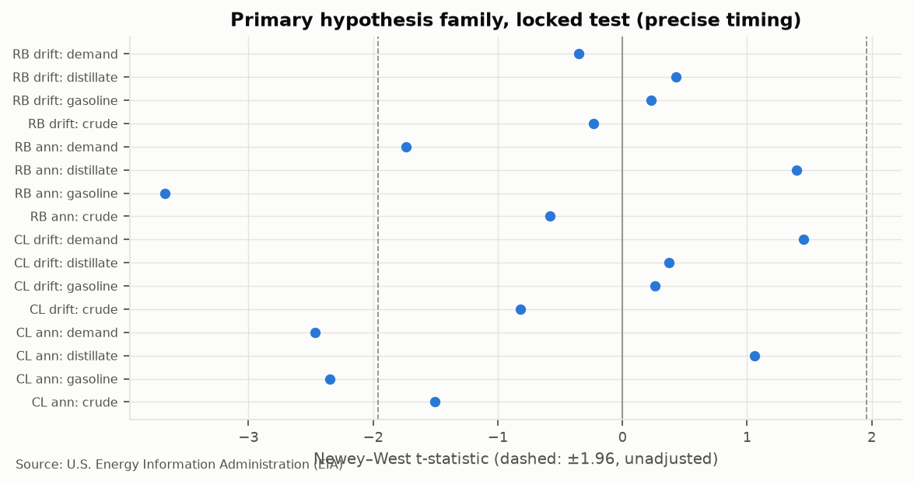

# Do EIA Gasoline-Demand and Inventory Surprises Predict Energy Futures?

[](https://github.com/aa5558/eia-surprises-energy-futures/actions/workflows/ci.yml)

[](LICENSE)

**A point-in-time event study and pre-registered out-of-sample trading test for WTI crude oil
(CL) and RBOB gasoline (RB) futures, 1996–2024.**

📄 **[Full research paper (PDF, 12 pages)](reports/Energy_Futures_Research.pdf)** ·
**[One-page summary (PDF)](reports/Research_Summary.pdf)** ·
[Markdown report](docs/REPORT.md)

> **In brief**
> - **Finding:** gasoline-inventory surprises move RBOB futures on the day of the EIA release.
>   This survives a multiple-testing correction in a locked 2017–2024 test.
> - **Negative result:** the surprises do not predict returns *after* the release. The
>   pre-registered trading strategy lost money out of sample and failed all three success
>   criteria.
> - **Method:** point-in-time data, a protocol committed before any futures return was examined,
>   and a test period locked in code until the specification was frozen.

---

## Overview

Every Wednesday the U.S. Energy Information Administration (EIA) publishes weekly gasoline
demand and petroleum inventories. Futures already price the predictable part of these numbers,
so only the **surprise** (actual minus expected) can move prices.

This project does four things:
1. builds those surprises using only information available before each release;
2. measures how CL and RB futures react;
3. tests whether a trading strategy can profit *after* the release;
4. evaluates the strategy once, on a 2017–2024 period that was locked in code until the full
   specification was frozen in git.

## Research questions

| | Question | Tradable with daily data? |
|---|---|---|
| **Q1** | Do surprises move futures between the settlements just before and just after the release? | No: a diagnostic of the surprise measure |
| **Q2** | Do surprises predict returns from the first settlement after the release to the last settlement before the next one? | Yes |



## Key findings

> **The announcement-day reaction is real. The post-release trading strategy failed.**

### ✅ Statistically significant: release-day price reaction (Q1)

- **Gasoline-inventory surprises move RBOB futures on release day**: −0.74% per one-sd
  surprise, t = −3.67, **Holm-adjusted p = 0.004** across 16 pre-registered tests, in the locked
  2017–2024 test. This replicates the development-period sign.
- The crude-inventory → WTI reaction, strong in 2011–2016 (t = −4.68), **did not replicate**
  (t = −1.51).


Of the 16 pre-registered tests, only RBOB ← gasoline survives the Holm correction. Two CL
announcement coefficients pass ±1.96 before correction (Holm p = 0.20 and 0.27). No drift
coefficient comes close.



### ❌ Not supported: post-release drift and the trading strategy (Q2)

- **No post-release drift:** all 8 drift coefficients have Holm p = 1.00.
- **Forecasts underperform the historical mean** out of sample: R² of −1.5% (CL) and −1.8% (RB).
- **The pre-registered strategy lost money out of sample.** Net Sharpe was **−0.50**,
  95% CI [−1.14, +0.14], Deflated Sharpe Ratio 0.0008, Hansen SPA p = 1.00. It failed all three
  pre-registered success criteria.
- **Costs were not the cause.** Base costs were $12.3k against a $297k gross loss.

## Performance: locked out-of-sample test

379 weeks, 2017-01 → 2024-04-05; base costs; non-compounded returns on a $1M capital base.

| Strategy | Gross Sharpe | **Net Sharpe** | Net return / yr | Volatility / yr | Max drawdown |
|---|---|---|---|---|---|
| **Rule A (primary)** | −0.48 | **−0.50** | −4.2% | 8.4% | −34.3% |
| Rule B (vol-scaled) | −0.57 | −0.62 | −11.7% | 18.9% | −93.6% |
| Always long | +0.13 | +0.07 | +1.5% | 20.9% | −59.6% |
| Price-only benchmark | −0.32 | −0.33 | −2.4% | 7.3% | −22.6% |

Every strategy that looked positive in development (net Sharpe +0.15 to +0.77) reversed in the
locked test. That is the signature of selection on noise, which the locked test exists to catch.


## Methodology

**Point-in-time data**
- **Release times are documented, not assumed.** EIA's archived schedule pages document the
  time for 791 of 793 weekly reports. Where the time is unknown, the trade waits until the
  information is certainly public.
- **First-published values, not revisions.** 793 archived reports were diffed against today's
  history files. This uncovered a 30.6-million-barrel restatement of crude stocks in 2016, which
  changed 61 of 283 weekly crude surprises (2011–16) relative to what the market saw.
- **Contract-aware futures P&L:**
  - exchange-documented expiries (archived CME calendars and the NYMEX rulebook);
  - rolls 5 days before expiry;
  - dollar P&L within the contract actually held;
  - four transaction-cost tiers, including roll trades.

**Surprises.** Actual minus forecast. Three pre-registered expectation models were compared by
out-of-sample error; a seasonal regression with AR(1) residuals won for every series.


**Statistics**
- Newey–West regressions with Holm and Benjamini–Hochberg corrections across a 16-test family.
- Walk-forward forecasts compared with Campbell–Thompson out-of-sample R², Clark–West and
  Diebold–Mariano tests.
- Strategy inference:
  - stationary-bootstrap Sharpe confidence intervals;
  - the Deflated Sharpe Ratio (all 20 development trials counted);
  - Hansen's SPA test;
  - year-block permutation and turnover-matched random-sign nulls.

**Research integrity**
- The [analysis protocol](docs/04_analysis_protocol.md) was committed before any futures return
  was examined.
- Data from 2017 onward is blocked in code until a `spec-freeze-*` git tag exists.
- The test script refuses to run if the code differs from the tag.
- The locked test was run once from `spec-freeze-v1`. A re-run produced byte-identical tables.
- One development-stage amendment is disclosed and counted against the results.
- Every specification tried is in the [experiment log](docs/experiment_log.md).
- Git history was rewritten once before publication, for privacy only; no code logic, data or
  result changed. See the [repository history note](docs/repository_history.md). Commit dates
  show the order of the work but are not independent proof of timing.

## Limitations

- **Daily settlements** cannot see the first minutes after the 10:30 release.
- **Power:** the 379-week test can detect only large effects (correlation ≈ 0.10).
- **Model-based surprises** stand in for consensus forecasts.
- **Before 2011** the analysis relies on restated history.
- **The futures data ends on 2024-04-05**, when EIA stopped publishing it.

See §13 of the [report](docs/REPORT.md) for the full list.

## Reproduction

Requires [uv](https://docs.astral.sh/uv/), which installs Python 3.12 and the locked
dependencies. Clone with tags (the default), because the locked test checks the
`spec-freeze-v1` tag.

```bash
git clone https://github.com/aa5558/eia-surprises-energy-futures.git
cd eia-surprises-energy-futures
uv sync
```

**1. Tests and lint (no data or network needed).** 117 tests on synthetic data with known
answers. The same checks run in CI on every push.

```bash
uv run pytest
uv run ruff check .
```

**2. Figures and PDFs from the saved result tables (no data download needed).**

```bash
uv run python scripts/report_figures.py
uv run python scripts/paper_figures.py
uv run --group docs python scripts/build_papers.py   # every number checked against reports/tables/
```

**3. Full pipeline from public data.** Downloads EIA files and archived EIA/CME pages (about
30 minutes). Raw files go to `data/raw/` and are recorded with SHA-256 hashes in
`data/raw/MANIFEST.json`; they are not committed.

```bash
uv run python -m transport_energy.data.build             # download + validate; --offline re-parses the cache
uv run python -m transport_energy.analysis.eda           # exploratory analysis (development data only)
uv run python -m transport_energy.analysis.development   # model selection -> configs/frozen_spec.yaml
```

**4. The locked out-of-sample test.** It has already been run once, and its outputs are in
[`reports/tables/phase7/`](reports/tables/phase7/). To confirm that the code and configuration
in your checkout are exactly the frozen ones, without running the test:

```bash
TEQ_UNLOCK_TEST=spec-freeze-v1 uv run python -c \
  "from transport_energy.analysis.locked_test import verify_frozen; print(verify_frozen())"
```

Re-running the test after step 3 executes the same frozen procedure and overwrites
`reports/tables/phase7/`. It refuses to start if `src/` or `configs/` differ from the tag.

```bash
TEQ_UNLOCK_TEST=spec-freeze-v1 uv run python -m transport_energy.analysis.locked_test
```

## Repository layout

```
configs/      research.yaml (splits, timing, contracts, costs), data.yaml (sources), frozen_spec.yaml
src/transport_energy/
  data/         downloads + manifest, EIA parsing, release calendar, first-release tables, exchange calendar
  features/     surprise models, event windows, contract-aware returns
  backtesting/  expiries and rolls, dollar P&L, costs, event backtester
  evaluation/   metrics; inference (Newey–West, Clark–West, Diebold–Mariano, bootstrap, DSR, SPA)
  analysis/     datasets, EDA, development (model selection), locked test
  timing.py     release -> settlement mapping (strict anti-look-ahead)
  integrity.py  code-enforced lock on the 2017+ test period
tests/        unit + integration tests on synthetic data with known answers
scripts/      presentation: figures and PDFs from saved result tables
docs/         design docs, protocol, data-quality report, experiment log, report, learning notes
reports/
  tables/       result tables; phase7/ holds the locked-test results
  figures/      figures; phase7/ holds the locked-test figures
                (phase7_dryrun_dev/ in both: development-data dry run, mechanics only, not results)
  *.pdf         research paper and one-page summary
```

## Data attribution

U.S. Energy Information Administration (EIA): Weekly Petroleum Status Report and petroleum price
series (public domain). NYMEX contract rules: CME Group NYMEX Rulebook chapters 200 and 191.
Archived EIA and CME pages come from the Internet Archive. No vendor data is used or
redistributed.

## License

Code is released under the [MIT License](LICENSE).

*Author: Amit Aviv, Columbia University (Mathematics & Economics).*
