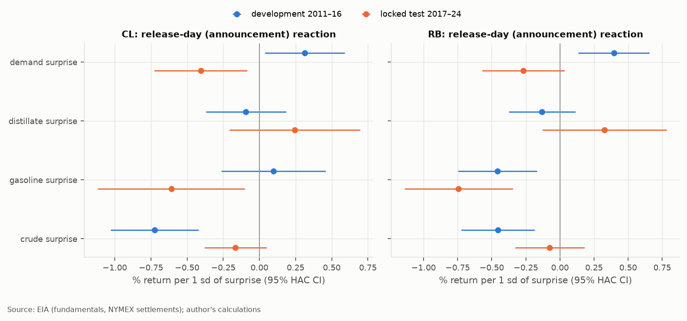
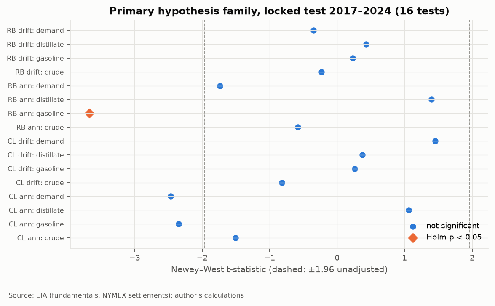
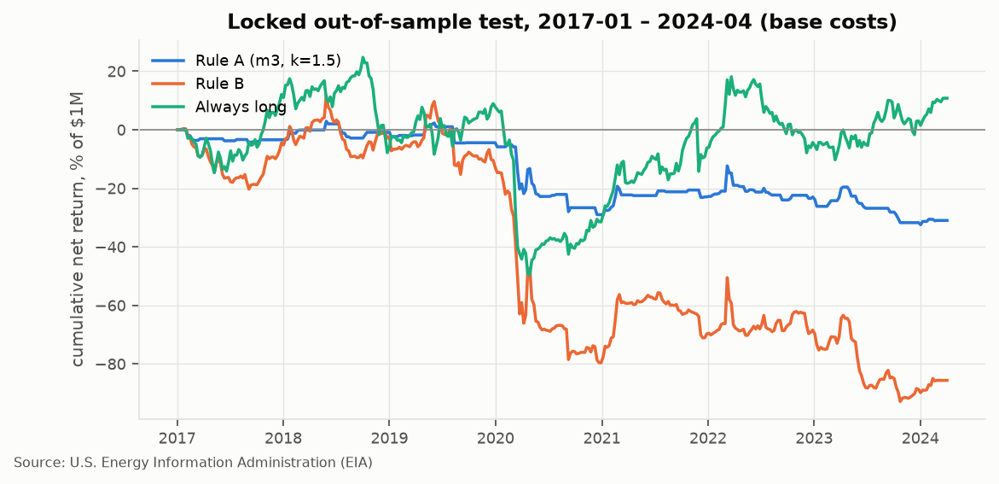
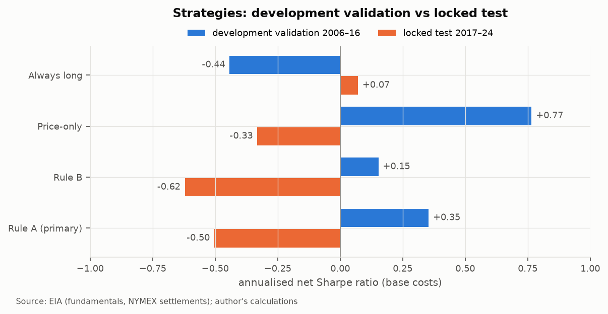
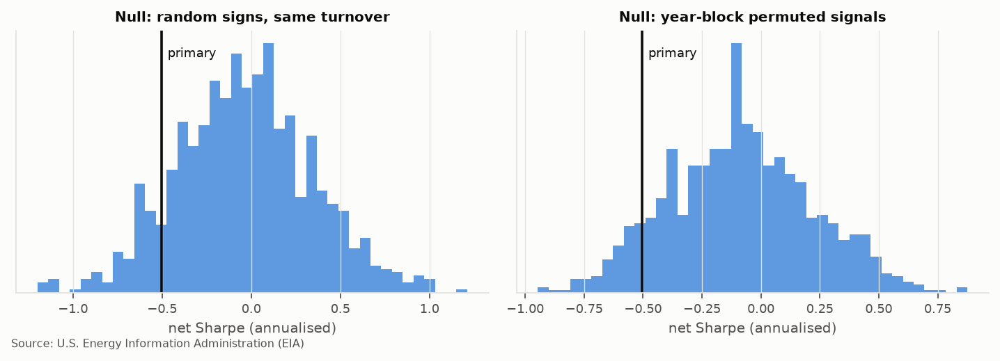
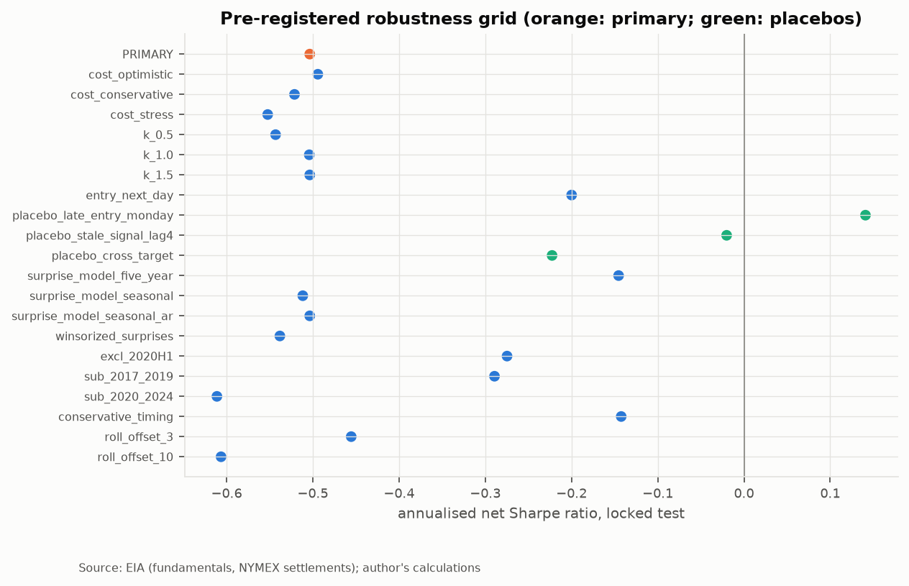

# Do EIA Gasoline-Demand and Inventory Surprises Predict Energy Futures Returns?

### A point-in-time event study and pre-registered trading test, WTI (CL) and RBOB (RB) futures, 1996–2024

*Author: Amit Aviv · Columbia University (Mathematics & Economics) · October 2026*
*Code and data pipeline: this repository. Every number in this report is produced by the
commands in §15 and stored in `reports/tables/`.*

---

## 1. Executive summary

**Question.** The EIA publishes US gasoline demand and petroleum inventories every Wednesday.
1. Do the *unexpected* parts of these numbers move NYMEX crude (CL) and gasoline (RB) futures
   on release day?
2. Do they predict returns *after* the release, when a trader can act on them?

**Design.**
- Model-based surprises, built only from data published before each release, and from
  *first-published* values rather than later restatements.
- Release windows from documented release schedules.
- Contract-aware P&L from exchange-documented expiries.
- 1996–2016 for development; **2017-01 → 2024-04-05 locked**, evaluated once after a committed,
  git-tagged specification freeze.

**Findings.**

| | Result |
|---|---|
| **Release-day reaction (Q1)** | Real, but only partly stable. In the locked test, **gasoline-inventory surprises move RBOB**: −0.74% per 1 sd of surprise, t = −3.7, Holm p = 0.004 across 16 tests. This replicates the development sign. The strong crude → WTI effect from development (t = −4.7) **did not survive**: t = −1.5. |
| **Post-release drift (Q2)** | **None.** All 8 drift coefficients have Holm p = 1.00. Forecasting models have *negative* out-of-sample R² (best: −1.5% CL, −1.8% RB). |
| **Primary trading strategy** | **Failed.** Net Sharpe **−0.50**, 95% bootstrap CI [−1.14, +0.14], Deflated Sharpe Ratio 0.001, SPA p = 1.00, year-permutation p = 0.91. It lost money gross (−4.1% a year); costs were only 0.17% a year. |
| **Verdict** | By the pre-registered criteria (CI > 0, DSR > 0.95, SPA p < 0.05): **no reliable evidence of a tradable post-release effect** with daily settlement data. |

**Interpretation.** Weekly EIA information is incorporated by the first settlement after the
release. What remains is not predictable with these methods. That is the efficient-markets
outcome a power analysis anticipated before any data was seen (§9.4). The project's value lies
in the measurement and the protocol, which made this conclusion trustworthy rather than a
by-product of overfitting.

---

## 2. Research question and economic motivation

**Why weekly EIA data?**
- *Gasoline product supplied* is the best high-frequency public measure of US transportation
  fuel demand.
- Inventories are the buffer between supply and demand. Under the **theory of storage**, an
  unexpected inventory build lowers the convenience yield and the spot price, especially when
  stocks are scarce.

**Why only surprises?** Predictable variation (seasonality, holidays, trend) is already in the
futures curve. Only information the market did not expect can move prices:

$$s_t = y_t - \mathbb{E}[y_t \mid \mathcal{F}_{t^-}].$$

**Two questions, kept separate.**
1. **Q1, announcement (diagnostic, not tradable with daily data).** Does
   $r^{ann}_t = P_{post}/P_{pre} - 1$ respond to $s_t$? If not, the surprise measure is too
   noisy and Q2 is uninformative.
2. **Q2, drift (tradable).** From the first settlement after the release to the last settlement
   before the next release: does the price keep moving (underreaction) or revert
   (overreaction)? Theory does not fix the sign, so the test is two-sided.

**Relation to the literature.** Announcement effects of EIA inventory news are well documented,
for example Halova, Kurov & Kucher (2014, *J. Futures Markets*). The tradable *post-release*
question, under realistic execution timing, is studied much less.

---

## 3. Data sources and construction

| Data | Source | Period |
|---|---|---|
| Weekly fundamentals (gasoline product supplied, crude ex-SPR, gasoline and distillate stocks) | EIA hist_xls bulk files | 1982/1991 → 2026-10 |
| NYMEX settlements, CL and RB contracts 1–3 | EIA (stopped after 2024-04-05) | 1983/2005 → 2024-04-05 |
| Release dates for 793 WPSR editions | EIA WPSR archive | 2011-08 → 2026-10 |
| First-published values | Archived WPSR Table 1, every edition | 2011-08 → 2026-10 |
| Release-time schedules | EIA schedule page, live + 194 archived copies (Internet Archive) | 2006 → 2026 |
| Contract expiries | CME product calendars (96 archived copies); NYMEX Rulebook ch. 200/191 | 1983 → 2024 |

- All 1,105 files are hashed (SHA-256) and logged with source URL and download time in
  `data/raw/MANIFEST.json`.
- Full details are in [docs/03_data_quality_report.md](03_data_quality_report.md).

**Three construction choices that matter.**

1. **First-published values.**
   - In October 2016, EIA restated commercial crude stocks: the next edition re-printed the
     prior week 30.6 million barrels lower. The current history file applies the new
     definition backwards.
   - As a result, **the weekly change the market saw differs from today's history in 61 of 283
     development weeks**.
   - Surprises therefore use each archived edition's own printed values from August 2011 on.
2. **Contract-aware returns.**
   - EIA's "contract 1" silently rolls at expiry, so returns are computed within the contract
     actually held. The position rolls 5 business days before the exchange-documented expiry.
   - P&L is in dollars per contract. That matters because WTI settled at −$37.63 on 2020-04-20.
3. **An exchange business-day calendar**, not EIA's price dates. EIA omits abbreviated
   sessions, which would shift rule-based expiries by a day.

---

## 4. Information availability and look-ahead prevention

Each kind of leakage is closed by a specific mechanism:

| Leak | Mechanism | Where |
|---|---|---|
| Using a number before its release time | Release *intervals*: windows close at the earliest possible release time and open after the latest | `data/release_calendar.py`, `timing.build_event_table` |
| Assuming release times | A time is used only if a schedule in force documents it **and** the observed date matches; 791/793 documented, 2 conservative | §3 of doc 03 |
| Pre-2011 releases with unknown dates | Assumption A (public by F+7 14:29), **tested: 0 violations in 635 non-holiday releases**; holiday weeks excluded | `configs/research.yaml` |
| Revised data | First-published values (§3) | `data/wpsr_tables.py` |
| Look-ahead in features | Expanding or trailing windows only; strict "<" as-of joins; tested by rewriting the future and asserting the past is unchanged | `tests/` |
| Training on unrealised returns | Walk-forward refits use only events whose **exit** is before the refit date | `analysis/modeling.walk_forward` |
| Researcher look-ahead | Protocol committed before any return analysis; 2017+ data blocked in code until a `spec-freeze-*` tag exists; test script refuses to run if code differs from the tag | `integrity.py`, `locked_test.py`, [docs/04](04_analysis_protocol.md) |

```
Fri F (data week ends) ─► Tue F+4 14:30 settle (P_pre) ─► Wed F+5 10:30 EIA release
   ─► Wed 14:30 settle (entry) ── drift window ──► Tue F+11 14:30 settle (exit, before next release)
```

---

## 5. Statistical methodology

**Surprises.** Three pre-registered expectation models: the 5-year same-week mean; a seasonal
regression (trend + 3 Fourier harmonics + holiday dummies, trailing 5 years); and the seasonal
regression plus AR(1). Each surprise is standardised by the expanding standard deviation of
*past* surprises: $z_t = s_t/\mathrm{sd}(s_{<t})$.

**Hypothesis tests.** For market $m$ and window $w$:

$$r^w_{m,t} = \alpha + \sum_{j=1}^4 \beta_j z_{j,t} + \delta' x_{m,t} + \varepsilon_t .$$

- $x$, used for the drift only: 1- and 4-week momentum, 20-day volatility and C1–C2 carry, all
  at entry.
- Newey–West standard errors with lag $\lfloor 4(n/100)^{2/9}\rfloor$.
- Holm and Benjamini–Hochberg corrections across the **16-test primary family**.

**Secondary families.**
- **Calendar spread:** crude surprise → CL spread change, announcement and drift windows.
- **H4:** surprise × prior-week inventory state, 4 tests.

**Forecasting.**
- Models: M0 mean; M1 price-only OLS; M2 M1 + surprises; M3 ridge; M4 logistic; M5 gradient
  boosting (pre-registered trigger).
- Annual walk-forward refits.
- Metrics:
  - Campbell–Thompson OOS $R^2 = 1-\sum(y-\hat y)^2/\sum(y-\bar y_{past})^2$;
  - Clark–West for nested models;
  - Diebold–Mariano for non-nested ones.

**Strategy inference.**
- Stationary-bootstrap Sharpe CI (Politis–Romano, mean block 8 weeks, 5,000 draws).
- Deflated Sharpe Ratio (Bailey & López de Prado 2014), with $N = 20$ development trials.
- Hansen (2005) SPA test across 16 tradable variants.
- Year-block permutation null (1,000 draws).
- Random-sign, turnover-matched null (1,000 draws).

---

## 6. Forecasting-model comparison

**Surprise models** (fundamentals only, out-of-sample 2001–2016; RMSE):

| Series | 5-yr mean | Seasonal | Seasonal + AR(1) |
|---|---|---|---|
| Crude stocks Δ (kb) | 3,751 | 3,597 | **3,589** |
| Gasoline stocks Δ (kb) | 2,361 | 2,263 | **2,208** |
| Distillate stocks Δ (kb) | 1,994 | 1,913 | **1,833** |
| Gasoline demand (kb/d) | 410 | 264 | **231** |

Seasonal + AR(1) wins all four. Diebold–Mariano p < 0.01 against the 5-year mean in every
series. The 5-year mean is biased by +146 kb/d for demand because it ignores the trend.

**Return forecasts** (drift window, out-of-sample $R^2$ vs historical mean):

| | M1 price-only | M2 OLS + surprises | M3 ridge | M5 boosting |
|---|---|---|---|---|
| Development validation 2006–16, CL | +0.04% | +0.40% | +0.49% | −1.97% |
| Development validation 2006–16, RB | −7.0% | −8.5% | −0.6% | −31.1% |
| **Locked test 2017–24, CL** | −3.6% | −4.0% | **−1.5%** | — |
| **Locked test 2017–24, RB** | −4.3% | −6.7% | **−1.8%** | — |

- Ridge validation chose the heaviest penalty on the grid (λ = 1000). Validation MSE fell
  monotonically toward the unconditional mean.
- The logistic direction model (M4) had a test hit rate of 50.1% (CL) and 51.9% (RB). Simply
  predicting "up" every week would have scored 56% and 58%.

---

## 7. Signal analysis (Q1 and Q2)



**Locked test, primary family** (precise timing; Holm across 16 tests):

| Test | Coefficient (% per sd) | t (NW) | Holm p |
|---|---|---|---|
| **RB announcement ← gasoline stocks** | **−0.74** | **−3.67** | **0.004** |
| CL announcement ← demand | −0.40 | −2.47 | 0.20 |
| CL announcement ← gasoline stocks | −0.61 | −2.35 | 0.26 |
| CL announcement ← crude stocks | −0.17 | −1.51 | 1.00 |
| All 8 drift coefficients | — | \|t\| ≤ 1.46 | 1.00 |

- Conservative timing gives the same picture. RB ← gasoline: t = −3.78, Holm p = 0.003.
- The development sample (in-sample) had stronger Q1 effects: crude → CL t = −4.7 and demand → RB
  t = +3.0.
  - Demand → RB **changed sign** in the test.
  - Crude → CL **shrank by three-quarters**.
- Possible reasons, which are hypotheses and were not tested:
  - more of the information leaking through the private API survey on Tuesday evening, which
    falls inside our announcement window;
  - a changed crude market after the 2015 export-ban repeal;
  - measurement error in model-based surprises.
- Secondary families are not significant in the test: spread p ≥ 0.34; H4 interaction Holm
  p = 1.0.
- The exploratory tercile split shows RB's gasoline-surprise slope concentrated in low-stock
  weeks (−0.60%, t = −4.4 vs 0.0 in high-stock weeks). That direction is consistent with
  storage theory, but it is not a confirmatory result.



---

## 8. Trading strategy design

- **Signal:** the standardised *conditional* drift forecast from M3,
  $\hat z_t = (\hat r_t - \overline{\hat r}_{train})/\mathrm{sd}(\hat r_{train})$, where both
  statistics come from the same refit.
  - This is amendment A1 to the protocol, made during development.
  - The first version used $\hat r_t/\mathrm{sd}$, which turned a heavily shrunk model into a
    constant short on the historical mean drift.
  - The amendment and the earlier trials are disclosed and counted in the Deflated Sharpe
    Ratio.
- **Rule A (primary):** long, short or flat. Take one volatility unit in the direction of
  $\hat z$ if $|\hat z| > k$, with $k = 1.5$ chosen in development from {0.5, 1, 1.5}.
- **Rule B:** $\mathrm{clip}(\hat z, -2, 2)$ units. This is equivalent to sizing
  $\propto \hat r/\hat\sigma^2$.
- **Sizing:** one unit = $\sigma^*/(\hat\sigma_d\sqrt{h}\,P\,M)$ contracts, where:
  - the target is $\sigma^* = 10\%/\sqrt{52}\times\$1\text{M}$;
  - $\hat\sigma_d$ is the trailing 60-day volatility, known at entry;
  - gross notional is capped at 2× capital;
  - contracts are rounded to integers.
- **Execution:** enter at the first settlement after the release; exit at the last settlement
  before the next release. Costs are per contract per side, including roll legs.
- **Benchmarks:**
  - always long;
  - price-only (Rule A on M1, same $k$);
  - random signs with the same contract schedule.

---

## 9. Backtesting results



| Locked test 2017-01 → 2024-04 (379 weeks, base costs) | Gross Sharpe | **Net Sharpe** | Net return / yr | Net vol / yr | Sortino | Max DD | Costs / yr |
|---|---|---|---|---|---|---|---|
| **Rule A (primary)** | −0.48 | **−0.50** | −4.25% | 8.4% | −0.65 | −34.3% | $1,693 |
| Rule B (vol-scaled) | −0.57 | −0.62 | −11.7% | 18.9% | −0.81 | −93.6% | $8,968 |
| Always long | +0.13 | +0.07 | +1.5% | 20.9% | +0.09 | −59.6% | $11,486 |
| Price-only benchmark | −0.32 | −0.33 | −2.4% | 7.3% | −0.44 | −22.6% | $790 |

Returns are on a fixed $1M capital base, not compounded, with 52 weeks a year.

- **Trades.** The primary strategy made 132 trades (62 CL, 70 RB), each about 4.5 contracts,
  with a 43.9% win rate. 7 events were skipped because a settlement was missing.
- **Where the losses came from.** 2020 accounts for −$246k of the −$310k total. Excluding
  2020-H1, the net Sharpe is still −0.28.



**Development vs test.** Every surprise-based strategy and the price-only benchmark were
positive in development validation (+0.15 to +0.77) and negative in the test. That reversal is
the typical signature of selection on noise. It is exactly what the locked test exists to
expose.

### 9.4 The prior: statistical power

To reach t ≈ 2 with $n$ weekly observations, the predictive correlation must be about
$\rho \gtrsim 2/\sqrt n$:
- with $n \approx 370$, that is $\rho \gtrsim 0.10$;
- by $SR \approx \rho\sqrt{52}$, that corresponds to a gross Sharpe of about 0.75.

Weekly commodity predictability is usually smaller than that. The study could only have
detected an unusually strong effect, and it found none.

---

## 10. Transaction-cost analysis

| Scenario (per contract per side) | CL | RB | Primary net Sharpe (test) |
|---|---|---|---|
| Optimistic: ½ tick + $1.50 | $6.50 | $3.60 | −0.49 |
| **Base: 1 tick + $2.50** | $12.50 | $6.70 | **−0.50** |
| Conservative: 2 ticks + $4.00 | $24.00 | $12.40 | −0.52 |
| Stress: 4 ticks + $5.00 | $45.00 | $21.80 | −0.55 |

- Primary turnover is about 179 contracts a year. Base costs total $12.3k over the test, against
  a gross loss of $297k.
- **The failure is not a cost problem.** The gross signal has no value.
- Rule B and always-long trade 5–6× more, so costs matter more for them.

---

## 11. Out-of-sample results: formal inference

| Statistic | Value | Criterion | Met? |
|---|---|---|---|
| Net Sharpe, 95% stationary-bootstrap CI | −0.50 [−1.14, +0.14]; P(SR ≤ 0) = 0.93 | CI > 0 | ✗ |
| Deflated Sharpe Ratio (N = 20, SR₀ = 0.092 per week, about 0.66 a year) | 0.0008 | > 0.95 | ✗ |
| Hansen SPA, 16 tradable variants vs zero | p = 1.00 | < 0.05 | ✗ |
| Year-block permutation | p = 0.91 | — | — |
| Random signs with same turnover | primary at 10.8th percentile | — | — |



---

## 12. Robustness checks (pre-registered)



- Every tradable variant has a negative net Sharpe, from −0.14 to −0.61. This covers:
  - all four cost scenarios;
  - $k$ ∈ {0.5, 1, 1.5};
  - roll offsets of 3 and 10 days;
  - Thursday entry;
  - all three surprise models;
  - winsorised surprises;
  - conservative timing;
  - both sub-periods.
- **Placebos.**
  - Late (Monday) entry: +0.14.
  - Stale signal from 4 releases earlier: −0.02.
  - Cross-market signal: −0.22.

  The placebos do no worse than the real signal. That is consistent with the signal carrying no
  post-release information.
- *Reporting quirk:* in the `excl_2020H1` row of `robustness_test.csv`, the per-market Sharpe
  columns do not apply the exclusion; only the combined Sharpe does. It is left as produced,
  because the evaluation code is frozen.

---

## 13. Limitations

1. **Daily settlements cannot see the first minutes after the release.** Any fast drift is
   missed. Intraday data (Databento, deferred) would measure how much of the reaction happens
   in the first minutes.
2. **The test sample is 7.3 years** (EIA futures end 2024-04-05). The power is enough only for
   large effects.
3. **Model-based surprises, not consensus forecasts.** Errors-in-variables attenuate
   coefficients. The private API survey on Tuesday evening pre-empts part of the information.
4. **Pre-2011 surprises use restated history** (no first-release archive). Release times are
   scheduled, not observed.
5. **Expiry dates after 2016 (RB) and after 2022-11 (CL) come from the validated rule**, which
   matched CME on 68/68 (RB) and 119/123 (CL). A one-day labelling ambiguity on expiry days
   affects roughly 2% of events, by about 0.5%.
6. **The H4 state variable** (a z-score against the prior 5 same weeks) explodes when stocks
   leave their range. It was kept as pre-registered.
7. **One development amendment (A1) was made after seeing development results.** It is
   disclosed, and its trials are counted.

---

## 14. Conclusions

1. EIA weekly inventory surprises carry **real announcement information**. The gasoline → RBOB
   effect replicated out of sample under a strict multiple-testing correction.
2. There is **no evidence of a tradable post-release drift** with daily settlements. Every
   strategy variant failed the pre-registered criteria, and the forecasts underperformed the
   historical mean.
3. Development-period success, including the price-only benchmark's +0.77 Sharpe, did not
   survive. Without the locked test, this project would have reported a profitable strategy.
4. **The next step is intraday:** measure the release-minute reaction directly, and test
   whether any drift exists in the hours a daily-bar study cannot see.

---

## 15. Reproduction

```bash
uv sync
uv run python -m transport_energy.data.build            # downloads + Phase 3 tables (about 30 min; --offline to re-parse)
uv run python -m transport_energy.analysis.eda          # Phase 4 (development only)
uv run python -m transport_energy.analysis.development  # Phases 5–6, writes configs/frozen_spec.yaml
TEQ_UNLOCK_TEST=spec-freeze-v1 uv run python -m transport_energy.analysis.locked_test   # Phase 7
uv run python scripts/report_figures.py                 # report figures from saved tables
uv run pytest && uv run ruff check .
```

**Data citation:** U.S. Energy Information Administration, Weekly Petroleum Status Report and
petroleum price series (public domain). NYMEX contract rules: CME Group, NYMEX Rulebook
chapters 200 and 191 (archived copies).
**Methods:**
- Newey & West (1987, 1994);
- Holm (1979); Benjamini & Hochberg (1995);
- Campbell & Thompson (2008); Clark & West (2007); Diebold & Mariano (1995);
- Politis & Romano (1994);
- Bailey & López de Prado (2014);
- Hansen (2005);
- Halova, Kurov & Kucher (2014).
